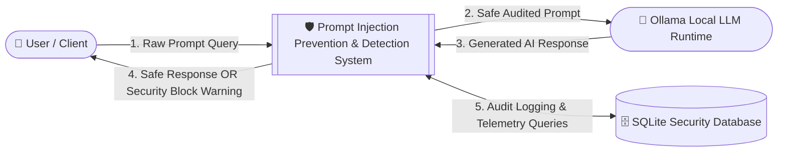
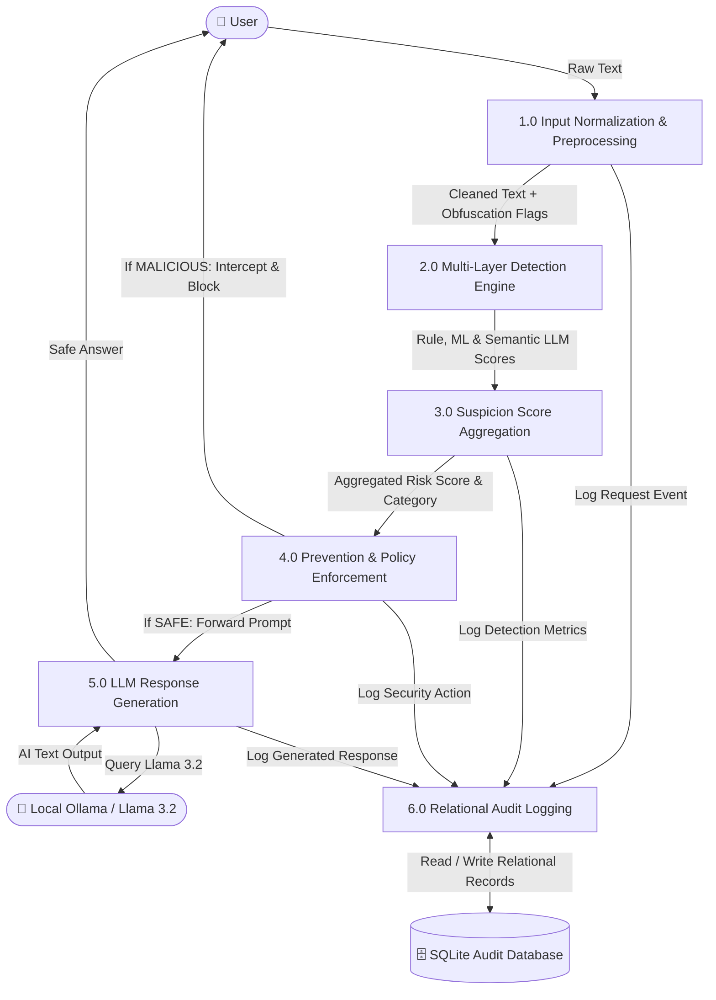

# Data Flow Diagrams (DFD)

This document provides formal **Level 0 (Context Level)**, **Level 1 (Top Level)**, and **Level 2 (Detailed Security Pipeline)** Data Flow Diagrams for the **Prompt Injection Prevention & Detection Framework**.

---

## 1. Level 0 DFD: Context Diagram

The Context Diagram defines the external entities (User and Local LLM Runtime) and the high-level boundary of the Prompt Injection Security System.



---

## 2. Level 1 DFD: Top-Level Functional Flow

Level 1 breaks down the system into its primary subsystems: Preprocessing, Detection, Prevention Decision, LLM Generation, and Logging.



---

## 3. Level 2 DFD: Deep-Dive Security Pipeline

Level 2 details the internal mechanics of the Multi-Layer Detection Engine (2.0) and Prevention Decision (4.0).

```mermaid
flowchart TD
    In[Normalized Input + Decoded Tokens]

    subgraph Detection Layer
        D1[2.1 Rule Detector: Category Matchers & Heuristics]
        D2[2.2 ML Classifier: TF-IDF + Logistic Regression]
        D3[2.3 Semantic Llama Detector: Isolated Prompt]
        
        In --> D1
        In --> D2
        In --> D3

        D1 -->|Rule Score [0.0 - 1.0]| Agg[2.4 Suspicion Score Aggregator]
        D2 -->|ML Probability [0.0 - 1.0]| Agg
        D3 -->|Llama Risk [0.0 - 1.0]| Agg
    end

    subgraph Decision & Prevention Layer
        Agg -->|Fused Score: Σ w_i * S_i| Dec{3.0 Risk Threshold Evaluator}
        
        Dec -->|Score > 0.70: MALICIOUS| Block[4.1 Security Blocker]
        Dec -->|0.35 <= Score <= 0.70: UNCERTAIN| Policy[4.2 Policy Enforcer]
        Dec -->|Score < 0.35: SAFE| Safe[4.3 Safe Dispatcher]

        Block -->|Generate Explainable Alert| OutBlock[Send Block Notice to User & Halt]
        Policy -->|Apply Strict Action| OutBlock
        Safe -->|Send to Generator| LLM[5.0 Ollama Llama 3.2 Generator]
    end
```
